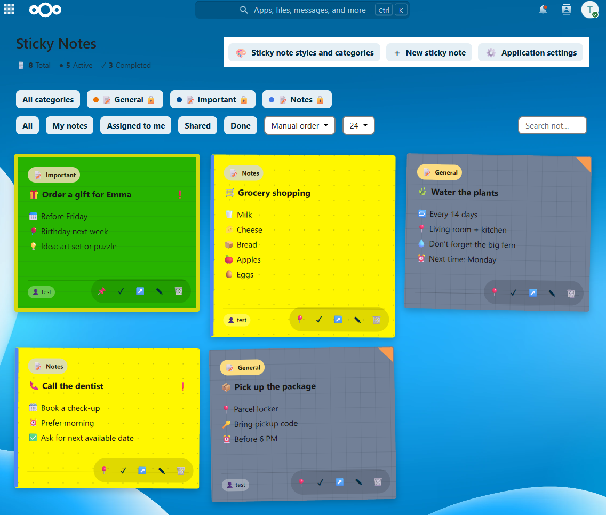

[🇨🇿 Česky](README_CZ.md) | [🇬🇧 **English**](README.md)

# Sticky Notes 2.0.14

Sticky Notes is a Nextcloud application for colorful personal and shared notes, tasks with deadlines, categories, Dashboard widgets and optional notifications. Notes can be shared with users or groups with view/edit permissions.



## Install — Nextcloud App Store (recommended)

**For regular users and administrators, install the official signed release through Nextcloud, not by executing the GitHub source installer.**

1. In Nextcloud, sign in as an administrator and open **Apps**.
2. Find **Sticky Notes** (`hc_stickynotes`) in the Nextcloud App Store and install the latest officially published release.
3. Install and enable **Hacesoft Shared App Core** (`hc_shared_app_core`) version **0.18.8 or newer** first, then install/enable Sticky Notes.
4. For updates, use the normal **Apps** update mechanism. Back up the database and application data before upgrading.

Requirements: **Nextcloud 35**, **PHP 8.3+**, enabled [Hacesoft Core](https://github.com/hacesoft/core) 0.18.8+. This is a separate required application and is not bundled with Sticky Notes. The newest source version may not yet be published in the App Store; a GitHub source ZIP is **not** a signed App Store package.

[Detailed installation instructions](docs/en/INSTALL.md) · [Nextcloud App Store](https://apps.nextcloud.com/)

## For developers and custom Docker deployments

This repository contains complete *application* source code. `install.sh` is a **developer/maintainer deployment tool for a specific Docker-based Nextcloud layout** (including Synology NAS setups), **not the recommended end-user installation method**. It requires `sudo`, a working Docker CLI and access to the Nextcloud containers. It is not a generic Nextcloud installer:

```sh
sudo sh install.sh
```

Do not execute it on a production Nextcloud instance simply because it is included on GitHub. Review the script, deployment requirements and backups first. Likewise, `sudo sh uninstall.sh` is for maintainers of that Docker deployment, not the normal Apps interface.

`sh build-release.sh` creates one public `hc_stickynotes-2.0.14-full-source.zip` **input ZIP for Hacesoft Publisher**, plus the two **unsigned internal build artifacts** `hc_stickynotes-2.0.14.zip` and `hc_stickynotes-2.0.14.tar.gz` required by Publisher 0.3.34. Only the `-full-source.zip` is submitted to Publisher. Publisher verifies the runtime and handles signing and publication; none of these build artifacts is a signed App Store package. Official releases undergo Hacesoft Publisher CP21 / HDS checks and app-signing separately, using the maintainer's private key (never distributed in this repository).

[Developer guide](docs/en/DEVELOPMENT.md) · [Update guide](docs/en/UPDATE.md)

## Documentation

[Documentation index](docs/en/README.md) · [User guide](docs/en/USER_GUIDE.md) · [Categories](docs/en/CATEGORIES.md) · [Sharing](docs/en/SHARING.md) · [Editor](docs/en/EDITOR.md) · [Dashboard](docs/en/DASHBOARD.md) · [Settings](docs/en/SETTINGS.md) · [Notifications](docs/en/NOTIFICATIONS.md) · [Mobile layout](docs/en/MOBILE_LAYOUT.md)

## Source and release files

- `src/` — full application source (PHP, JavaScript, CSS, translations, templates, metadata).
- `docs/` — public Czech/English documentation; screenshots are kept separately in the GitHub-root `screenshot/` directory.
- `install.sh`, `uninstall.sh`, `scripts/` — developer deployment and recovery helpers.
- `build-release.sh` — prepares one public `-full-source.zip` for Publisher plus unsigned runtime ZIP/TAR.GZ intermediates in `release/` (not for public installation).

The GitHub source archive does not include private HDS/CP21 audit records, internal tests, test-run evidence, private keys, personal data or runtime backups. It is **not** a substitute for the official signed App Store package.

[Changelog](CHANGELOG.md) · [License: AGPL-3.0-or-later](LICENSE).

## Localization

The UI ships with 11 language catalogs: `cs`, `en`, `de`, `es`, `fr`, `it`, `nl`, `pl`, `pt`, `sk`, `uk`. English is the fallback language. User/developer documentation is provided in Czech and English.
