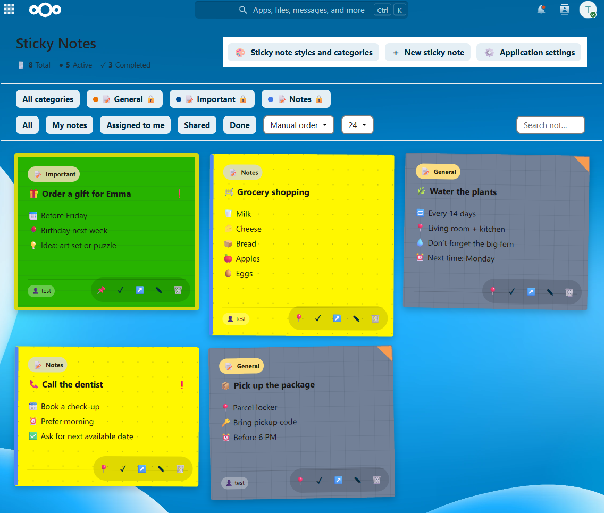

[🇨🇿 **Česky**](README_CZ.md) | [🇬🇧 English](README.md)

# Žluté lístečky 2.0.14

Aplikace Sticky Notes pro Nextcloud: barevné osobní a sdílené poznámky, úkoly s termíny, kategorie, widget Dashboardu a volitelná oznámení. Lístečky lze sdílet s uživateli nebo skupinami s právem prohlížení či úprav.



## Instalace — Nextcloud App Store (doporučeno)

**Pro běžné uživatele a správce je určen oficiálně podepsaný balíček instalovaný přes Nextcloud. Neinstalujte aplikaci běžně spouštěním skriptu ze zdrojového ZIPu na GitHubu.**

1. Přihlaste se do Nextcloudu jako správce a otevřete **Aplikace (Apps)**.
2. V Nextcloud App Store vyhledejte **Sticky Notes / Žluté lístečky** (`hc_stickynotes`) a nainstalujte poslední oficiálně vydanou verzi.
3. Nejprve nainstalujte a zapněte **Hacesoft Shared App Core** (`hc_shared_app_core`) **0.18.8 nebo novější**, poté nainstalujte a zapněte Lístečky.
4. Aktualizace provádějte standardně přes správu **Aplikace**. Před aktualizací zálohujte databázi i data Nextcloudu.

Požadavky: **Nextcloud 35**, **PHP 8.3+**, zapnuté [Hacesoft Core](https://github.com/hacesoft/core) 0.18.8+. Core je samostatná povinná aplikace a není přibalena k Lístečkům. Nejnovější zdrojová verze nemusí být v App Storu dosud zveřejněna; samotný zdrojový ZIP z GitHubu **není podepsaný balíček pro App Store**.

[Podrobný návod k instalaci](docs/cz/INSTALL_CZ.md) · [Nextcloud App Store](https://apps.nextcloud.com/)

## Pro vývojáře a vlastní Docker nasazení

Tento repozitář obsahuje úplné *zdrojové kódy aplikace*. `install.sh` je **vývojářský/správcovský instalační nástroj pro konkrétní Dockerové nasazení Nextcloudu** (například Synology NAS), **nikoli doporučený způsob běžné instalace**. Vyžaduje `sudo`, funkční Docker a přístup ke kontejnerům. Není univerzálním instalátorem Nextcloudu:

```sh
sudo sh install.sh
```

Nespouštějte jej na produkčním serveru jen proto, že je na GitHubu. Nejprve prostudujte skript, způsob nasazení a zálohování. Také `sudo sh uninstall.sh` slouží správcům tohoto Dockerového nasazení, nikoli k běžnému odebrání aplikace přes rozhraní Nextcloudu.

`sh build-release.sh` připraví **jediný veřejný vstupní ZIP** `hc_stickynotes-2.0.14-full-source.zip` pro Hacesoft Publisher a dále dva **interní nepodepsané sestavovací výstupy** `hc_stickynotes-2.0.14.zip` a `hc_stickynotes-2.0.14.tar.gz`, které vyžaduje Publisher 0.3.34. Publisheru se předává pouze `-full-source.zip`. Runtime kontroluje, podepisuje a publikuje Publisher; sestavení **není podpis ani publikace**. Oficiální vydání následně prochází kontrolami Hacesoft Publisher CP21 / HDS a podpisem soukromým klíčem správce, který se nikdy nezveřejňuje.

[Vývojářská dokumentace](docs/cz/DEVELOPMENT_CZ.md) · [Aktualizace](docs/cz/UPDATE_CZ.md)

## Dokumentace

[Přehled dokumentace](docs/cz/README_CZ.md) · [Uživatelská příručka](docs/cz/USER_GUIDE_CZ.md) · [Kategorie](docs/cz/CATEGORIES_CZ.md) · [Sdílení](docs/cz/SHARING_CZ.md) · [Editor](docs/cz/EDITOR_CZ.md) · [Dashboard](docs/cz/DASHBOARD_CZ.md) · [Nastavení](docs/cz/SETTINGS_CZ.md) · [Oznámení](docs/cz/NOTIFICATIONS_CZ.md) · [Mobilní rozložení](docs/cz/MOBILNI_LAYOUT.md)

## Co obsahuje zdrojový balíček

- `src/` — úplné zdroje aplikace (PHP, JavaScript, CSS, překlady, šablony a metadata).
- `docs/` — veřejné návody CZ/EN; screenshoty jsou samostatně v kořenovém adresáři GitHubu `screenshot/`.
- `install.sh`, `uninstall.sh`, `scripts/` — pomocníky pro vývojářské nasazení a obnovu.
- `build-release.sh` — vytvoří jeden veřejný zdrojový ZIP pro Publisher a interní nepodepsané runtime ZIP/TAR.GZ do `release/`.

Veřejný GitHub ZIP neobsahuje interní podklady HDS/CP21, vývojové testy ani jejich evidenci, soukromé klíče, osobní data nebo provozní zálohy. **Nenahrazuje oficiálně podepsaný balíček z App Store.**

[Přehled změn](CHANGELOG.cs.md) · [Licence: AGPL-3.0-or-later](LICENSE).

## Jazyky

Rozhraní obsahuje 11 jazyků: `cs`, `en`, `de`, `es`, `fr`, `it`, `nl`, `pl`, `pt`, `sk`, `uk`; náhradním jazykem je angličtina. Uživatelská a vývojářská dokumentace je v češtině a angličtině.
